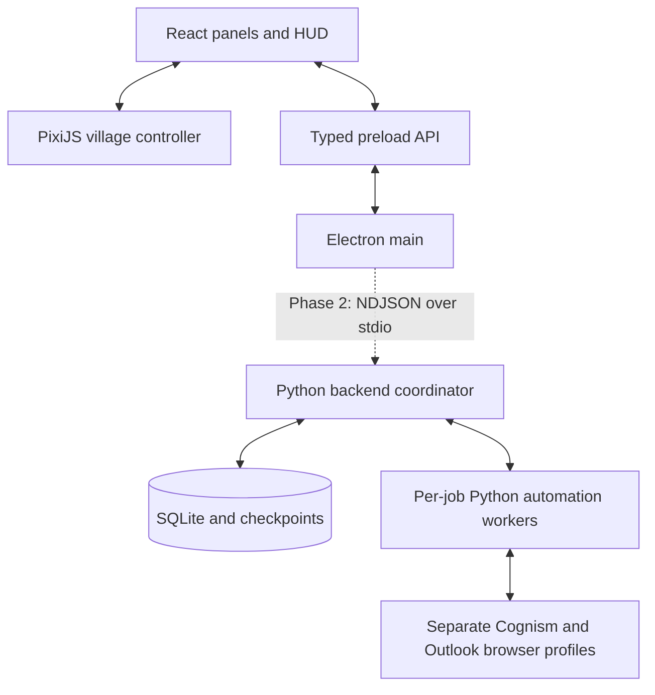

# Tachy-on Village — architecture and implementation plan

Prepared 23 October 2026 from the complete `Tachy-on_Village_PRD.md` and the current workspace. This is a proposal; application implementation starts only after the user approves Phase 1.

## 1. Repository findings

- The workspace contains the 573-line PRD, initially empty `README.md` and `AGENTS.md`, and empty `frontend/` and `assets/` directories. Three Python scripts appeared in `backend/scripts/` during planning and were inspected without importing or executing them.
- The scripts are `cognism_exporter.py` (236 lines), `outlook_drafter.py` (460 lines), and `account_exporter.py` (88 lines). No JavaScript application, dependency manifests, lockfiles, tests, or artwork were found, including a scan of hidden and ignored files. There is no `.git` repository in this directory.
- The PRD's `/mnt/data/image(1).png` reference is not available in this environment. Its written cube-character and palette guidance is sufficient for placeholders.
- `python3` and `git` resolve on the current shell's PATH; `node` and `npm` do not. Check for an existing Node installation and configure or install a supported toolchain during approved Phase 1 setup. No dependency installation has been performed.
- All three scripts use synchronous Python Playwright and persistent Chrome contexts, with browser work guarded by `__main__`. Preserve them in place. Static inspection does not establish compatibility with current live browser UIs; no scripts or authenticated browser sessions have been executed or changed.
- Planning changes consist of this document, project conventions, a README, and ignore rules. No Git initialization, commit, or application scaffold is part of this planning step.

### Existing automation and integration implications

| Script | Observed behavior | Implication for later phases |
| --- | --- | --- |
| [cognism_exporter.py](../backend/scripts/cognism_exporter.py) | Reads visible contact rows/dropdowns, preserves the PRD CSV columns, tracks email and Diamond badges separately, checks pagination stability, writes UTF-8-BOM CSV after each page and on exit | Retain selectors and parsing. Adapt `input()`/prints to explicit commands/events; add durable per-record checkpoints rather than treating page CSV writes as complete crash recovery. Existing in-memory duplicate checks use name/company. |
| [outlook_drafter.py](../backend/scripts/outlook_drafter.py) | Defaults to preview; creation requires `--create`; logs attempts before composing; inserts the fixed Default signature; saves via Ctrl+S; verifies subject visibility in Drafts; returns to Inbox; blocks ordinary retries for previously attempted contacts | Retain known browser steps. Add configurable templates/signature, structured events, and durable context-aware attempt records. Subject-only verification is insufficient to prove recipient/body/signature; test these explicitly before calling a draft confirmed in the app. Preserve review requirements for uncertain attempts. |
| [account_exporter.py](../backend/scripts/account_exporter.py) | Reads Salesforce account links and writes a CSV using its own persistent browser profile | Preserve as standalone source. Do not integrate or execute it: Salesforce extraction is explicitly outside V1. |

The Cognism exporter can join multiple emails using ` | `, whereas the drafter accepts one valid email per row. Phase 3 needs an explicit eligibility/selection step for multi-email records. The drafter currently has hardcoded message text, identifies attempts by email plus subject, and writes personal details to console/progress logs and a diagnostic screenshot directory. Adapters must preserve the original CLI while routing app outputs into controlled app-data locations, redacting UI diagnostics, and using job/template/cadence-aware identities. These are integration tasks, not Phase 1 changes. Ignore rules cover the observed profile, progress-log, temporary-log, and screenshot paths.

## 2. Proposed stack and responsibilities

| Layer | Choice | Responsibility |
| --- | --- | --- |
| Desktop | Electron + TypeScript | Window lifecycle, native dialogs, protected preload API, later Python process supervision |
| UI | React + TypeScript | HUD, accessible building menu, dialogs, future forms/tracker/calendar |
| World | PixiJS 8, WebGL initially | Isometric scene, sprites/placeholder geometry, pointer interaction, frame updates |
| Build | electron-vite with one root npm project | Separate main/preload/renderer builds and local development workflow |
| Navigation | Small pure TypeScript grid module | A* paths, obstacle clearance, coordinate transforms, movement |
| Backend, Phase 2 onward | Python coordinator and isolated automation workers | SQLite repositories, job state, checkpoints, existing Playwright integrations |
| Persistence, Phase 2 onward | SQLite plus user-accessible files | Canonical operational records; CSV/TXT/XLSX import/export |
| Art, later phases | Blender orthographic renders to PNG/JSON atlases | Replace placeholders without changing navigation or UI contracts |

PixiJS is the proposed fit because the product needs a fixed isometric presentation with layered sprites and DOM overlays. We can express the map with simple original geometry now and use the PRD's Blender-rendered sprites later. Camera rotation and a runtime 3D physics world are outside this design. PixiJS documents renderer, ticker, resize, and resolution controls in its [Application guide](https://pixijs.com/8.x/guides/components/application).

Use an imperative PixiJS scene mounted by one React component. React receives coarse events such as a location opening; frame-by-frame movement remains in the world controller. This keeps rendering lifecycle and input handling explicit without another scene abstraction dependency.

The desktop boundary follows [Electron's security guidance](https://www.electronjs.org/docs/latest/tutorial/security): isolated and sandboxed renderer, no Node integration, constrained navigation, restrictive CSP, and narrowly validated preload/IPC methods. [electron-vite](https://electron-vite.org/guide/) provides a shared configuration for the main, preload, and renderer builds. Exact compatible dependency versions and Node requirements will be verified and locked during Phase 1.

## 3. Process and data boundaries



Phase 1 implements only the desktop and renderer portion. There is no Python startup, database, network workflow, or simulated job progress. The preload API stays minimal until a native capability is needed; no generic command-execution API is added.

In Phase 2, Electron launches one known Python coordinator using an argument array and no shell. The coordinator owns transactional SQLite writes and supervises isolated job workers that wrap the user's preserved automation. Main handles app shutdown and backend liveness; the coordinator handles job cancellation and worker cleanup. This gives the database one logical writer and keeps browser automation off both UI event loops.

Use a versioned NDJSON request/event protocol with request ID, job ID, event ID/sequence, type, and validated payload. Parse partial lines, distinguish process exit from business completion, and bound message sizes. Persist confirmed events/checkpoints before acknowledging them to the UI; deduplicate repeated event IDs. Human login prompts are `waiting_for_user`, not errors. Uncertain draft saves remain reviewable and cannot be silently retried. The protocol and its fake-worker harness are Phase 2 work.

Main passes an OS-specific app-data location to Python. Keep the database, per-tool browser profiles, imports, exports, checkpoints, redacted logs, and preferences there, outside the repository and installation directory. User-picked files can live elsewhere. SQLite owns operational state; Excel exports are snapshots.

## 4. Proposed source layout

Preserve the existing directory names rather than introducing a second Python source root:

```text
electron/                   # main, preload, desktop lifecycle
frontend/
  components/               # accessible HUD, building list, dialogs
  world/                    # scene, camera, input, avatar, map definition
    navigation/             # pure grid/projection/pathfinding/movement logic
  modules/                  # location panels; full workflows in later phases
  styles/                   # PRD palette and UI styles
backend/
  scripts/                  # preserved Cognism, Outlook, Salesforce source
  workers/                  # later adapters around the original logic
  service/                  # later coordinator, repositories, migrations
shared/                     # later validated IPC/protocol contracts
assets/                     # original art; later Blender sources and atlases
tests/                      # focused unit tests and desktop smoke coverage
docs/                       # architecture, decisions, acceptance notes
```

Only create implementation directories when needed. A single npm package is sufficient for the first milestone. No monorepo framework, web server backend, cloud account, or installer pipeline is needed for Phase 1.

## 5. Phase 1 — playable village

**Outcome:** launch an actual Electron window into a polished prototype village, move a cube-like avatar around obstacles, control the camera, and inspect placeholder locations.

### Implementation sequence

1. **Desktop foundation:** resolve the Node/npm toolchain, add pinned dependencies and a lockfile, configure TypeScript and electron-vite, and create a secure, resizable Electron window. Support normal macOS window reactivation and Windows close behavior. Add real development/build/check commands to the README.
2. **World composition:** implement a data-driven isometric island with plum/lavender dusk, cream panels, warm lantern accents, stone paths, coastline, and simple vegetation. Use code-drawn geometric assets with consistent feet/ground anchors and depth ordering. Draw six clearly labeled placeholders: Dock west, Changing Room northwest, Calendar northeast, Arena southwest, Restaurant southeast, Settings near the edge. Spawn the avatar at the central junction.
3. **Camera and input:** bounded pan, wheel/trackpad zoom anchored to the pointer, keyboard and visible zoom controls, and a recenter/follow button. Use middle-button or Space+drag panning, arrow-key pan when the world has focus, `+`/`-` zoom, and `Home` to recenter. Manual pan suspends following until recenter. Ignore shortcuts in text inputs and dialogs. Separate a click from a drag using a small movement threshold.
4. **Navigation:** convert screen coordinates through the inverse camera and isometric projection to a world grid. Use A* with eight neighbors, diagonal corner-cut prevention, and blocked terrain expanded for avatar clearance. Keep walkable paths, building footprints, and entrances in one map definition. Move with elapsed time and clamp long frame gaps. A new destination replaces the remaining route from the avatar's current position without jumping across blocked cells. Show a destination marker; report unreachable clicks gently and do not teleport.
5. **Building interactions:** clicking a building routes to its reachable entrance and opens its named placeholder panel only on arrival. Redirecting the avatar cancels any pending arrival action. Hover shows a label/highlight. A keyboard-accessible building list opens the same panel immediately. Panels state that the workflow arrives in a later milestone; there are no functioning import/draft controls or fictional progress counts.
6. **Finish and verify:** add visible control hints, Escape-to-close and focus restoration, a reduced-motion option, responsive panels, and clear rendering-failure fallback. Target comfortable layouts at 1366×768 and 1440×900 and inspect high-DPI behavior. Verify development and production-build launch paths before handoff.

### Acceptance criteria

| ID | Required behavior and evidence |
| --- | --- |
| P1-01 | Electron launches the map successfully; a production build can launch without the development server. No backend/browser automation starts. |
| P1-02 | The village shows all six labeled placeholders, the central spawn, paths, water, and one original avatar. |
| P1-03 | Clicking reachable ground moves the avatar there around obstacles. Buildings and water cannot be crossed; diagonal gaps do not permit corner cutting. |
| P1-04 | Unreachable/out-of-map targets are handled safely. Repeated clicks replace the route without teleportation or stale building panels opening. |
| P1-05 | Pan, zoom, bounds, follow/recenter, and resize work together. Destination picking remains correct after camera changes. Dragging and clicking UI do not trigger avatar movement. |
| P1-06 | Building clicks route to an entrance and open the correct panel. Keyboard controls open equivalent panels; Escape closes and restores focus. |
| P1-07 | Movement is time-based; depth ordering lets the avatar pass naturally in front of and behind structures. Reduced motion removes decorative motion and camera easing. |
| P1-08 | Type checking, linting, focused unit tests, and build checks pass. Record actual Electron smoke results and any unavailable platform/display checks. |

Focused tests cover coordinate round trips and camera picking, obstacle routing and unreachable paths, diagonal clearance, movement retargeting, and building interaction cancellation. A small Electron smoke check covers window launch and basic UI; manual interaction checks cover pan/zoom, occlusion, pointer feel, and scaling. Aim for 60 FPS on the available desktop, measuring before claiming it. Windows verification needs a Windows runner or machine and cannot be inferred from a macOS run.

### Explicit boundary from the larger PRD milestone

The user's first milestone is narrower than PRD milestone 1. Phase 1 uses placeholder geometry and a single default avatar. Blender art, character selection, the faux event simulator, audio, full welcome/profile flow, business forms, Python integration, SQLite, contacts, scheduling, and signed installers are deferred. This keeps the first approval focused on the desktop village and its controls.

## 6. Later phases — roadmap only

| Phase | Deliverable | Gate / evidence |
| --- | --- | --- |
| 0 — current planning | Repository inspection, architecture, project conventions, data exclusions | User reviews and approves Phase 1 before application code is written |
| 1 — playable village | The bounded slice described above | P1-01 through P1-08; review of camera feel, readability, and map layout |
| 2 — backend foundation and Cognism | Adapt preserved exporter; Python NDJSON coordinator; migrations for contacts, imports, job runs, basic cadences/membership; user-controlled browser handoff; contact preview; durable events/checkpoints; dock feedback | Fake-worker and synthetic-fixture tests first. Explicitly authorized pilot verifies prepared-list handoff, counts, CSV compatibility, cancellation, checkpoint recovery, and no automatic restart |
| 3 — Outlook drafts | Adapt preserved drafter; template and signature controls; eligible-contact review; quantity selection; durable draft attempts; review/retry handling; bar feedback | Fake browser/job tests first. Explicitly authorized single-draft pilot verifies recipient/body/signature, save, Drafts confirmation, Inbox return, no Send, and safe uncertain outcomes |
| 4 — cadence arena and calendar | Full cadence/activity/task model and migration; manual sent dates and call outcomes; business-day scheduling; Monday-start calendar; stop rules; CSV/Excel snapshots | Deterministic date/time-zone tests, suppression across cadences, restart persistence, Start Now routing, and 12-visible-cadence pagination |
| 5 — art, accessibility, and distribution | Blender world and four original avatars; wardrobe; event-driven worker animations; original/licensed audio; performance options; onboarding; bundled Python/runtime strategy; installers | macOS and Windows acceptance runs, clean install/upgrade/migrations, Python/browser lifecycle, signing/notarization where applicable, and PRD release gates |

Persistence begins in Phase 2 rather than waiting for Phase 4: real imports and job recovery need durable records immediately. Full cadence scheduling and calendar UI remain Phase 4. Live pilot runs are separate from routine setup/tests and require explicit authorization; approving implementation does not authorize account activity.

## 7. Decisions and deferred dependencies

- Adopt PixiJS, fixed isometric projection, a grid with A*, and original placeholders for Phase 1. Revisit the renderer only if the actual prototype reveals a material limitation.
- Keep the existing `backend/scripts/` location and all three scripts unchanged during Phase 1. Later adapter design must account for the static findings above; live browser behavior remains unverified.
- Keep Phase 1 state in memory. Durable game preferences can be added with the backend foundation; no fake persistence promises.
- Define replacement-friendly map anchors and footprints now. Final art, original character designs, and soundtrack sourcing are later production decisions.
- Choose the Python distribution approach after reviewing actual script dependencies. Validate per-platform browser discovery and save shortcuts during integration; signed installers come after the functional pilot.
- Do not initialize or commit the workspace as part of planning. Before any later commit, review staged content in addition to `.gitignore` exclusions.

**Approval requested:** implement Phase 1 only, using the stack, controls, placeholder scope, and acceptance criteria above.
